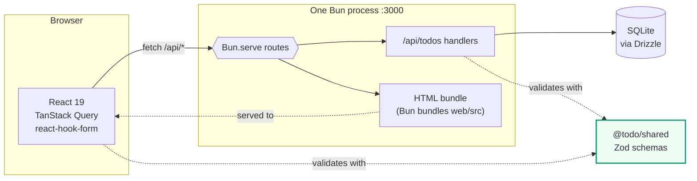

# Todo Notes — technical documentation

A single-user todo app: a Bun server with SQLite behind it, and a React grid of
note cards in front. One process serves both.

| Page | What it covers |
|---|---|
| [architecture.md](architecture.md) | How the pieces fit, how a request flows, how the frontend gets bundled |
| [data-model.md](data-model.md) | The `todos` table, soft delete, completion, and the sort order |
| [api.md](api.md) | The four endpoints, envelopes, status codes, error shape |
| [frontend.md](frontend.md) | Query keys, cache invalidation, the optimistic toggle, form validation |
| [development.md](development.md) | Setup, scripts, migrations, tests |

Product intent lives in [`../PRD.md`](../PRD.md); this folder describes how it
is built.

## Quick start

```bash
bun install
bun run dev     # http://localhost:3000
```

## The shape of it in one diagram



The dashed links to `@todo/shared` are the point of the layout: the server and
the form validate with **the same schema object**, so the API and the UI cannot
disagree about what a valid todo is.
