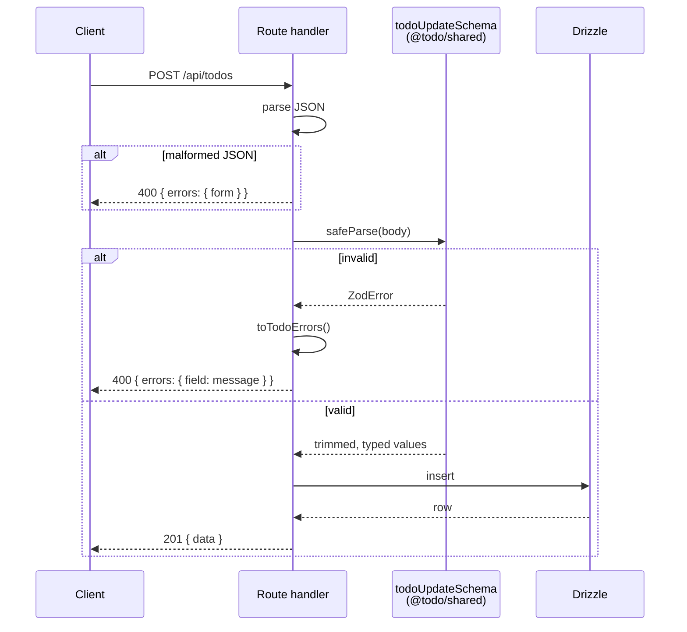

# API

Four endpoints under `/api`, defined in
[`apps/server/src/routes/todos.ts`](../apps/server/src/routes/todos.ts). No
authentication — the app is single-user and local.

## Envelopes

Every response is one of two shapes:

```jsonc
{ "data": … }                                  // success
{ "errors": { "title": "Title is required." } } // failure
```

Error keys are **input field names**, so the form maps them straight back onto
the inputs that caused them. Anything not attributable to one field uses the
key `form`.

## Endpoints

| Method | Path | Success | Failures |
|---|---|---|---|
| `GET` | `/api/todos?filter=` | `200` `{ data: Todo[] }` | — |
| `POST` | `/api/todos` | `201` `{ data: Todo }` | `400` validation or bad JSON |
| `PUT` | `/api/todos/:id` | `200` `{ data: Todo }` | `400` validation or bad id · `404` missing |
| `DELETE` | `/api/todos/:id` | `200` `{ ok: true }` | `400` bad id · `404` missing |

### `GET /api/todos`

`filter` is one of `all` (default), `active`, `completed`. An unrecognised
value **degrades to `all`** rather than erroring — the schema's `.catch("all")`
means a stale bookmark or a hand-edited URL still renders a page.

Soft-deleted todos are excluded under every filter. Results use the
[sort order](data-model.md#sort-order).

### `POST /api/todos`

```jsonc
{ "title": "Ship it", "description": "All of it", "dueDate": "2026-09-30" }
```

Strings are trimmed before storage. `createdAt` and `updatedAt` are set
server-side and are equal on creation.

### `PUT /api/todos/:id`

Takes the same body plus an optional `completed` boolean:

- `completed: true` stamps `completedAt`, or leaves an existing one alone
- `completed: false` clears it
- omitted leaves completion untouched

The other three fields are always required and always revalidated, so an edit
cannot sneak an invalid todo past the schema.

### `DELETE /api/todos/:id`

Soft delete: sets `deletedAt` and `updatedAt`. The row stays on disk. A second
delete returns `404`, because the row is no longer visible.

## Validation



The schema is the **same object** the browser form validates with, so the two
cannot drift. Rules:

| Field | Rule | Message |
|---|---|---|
| `title` | non-empty after trim | `Title is required.` |
| `description` | non-empty after trim | `Description is required.` |
| `dueDate` | present | `Due date is required.` |
| `dueDate` | a real calendar date, `YYYY-MM-DD` | `Use YYYY-MM-DD.` |

"A real calendar date" is stricter than a pattern match. `2026-02-31` matches
`\d{4}-\d{2}-\d{2}` and is rejected anyway, because the value is round-tripped
through `Date.UTC` and compared back. Zod's own `z.iso.date()` is regex-based
and would accept it, which is why
[`isCalendarDate`](../packages/shared/src/todo.ts) is hand-written.

## Ids

`:id` must be a positive integer. `1.5`, `0`, `-1`, `abc` and the empty string
all return `400` rather than being coerced.

## Concurrency

`PUT` and `DELETE` read the row and write it inside a single transaction, so a
concurrent delete cannot land between the existence check and the write.
