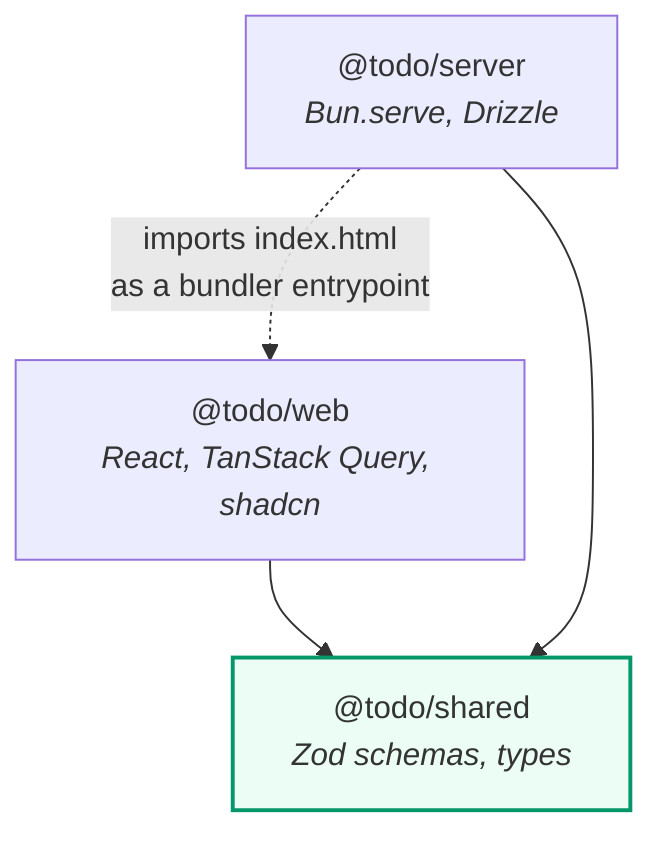
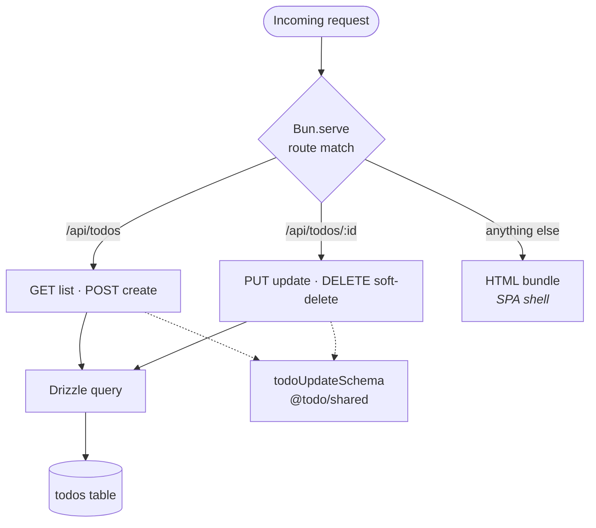
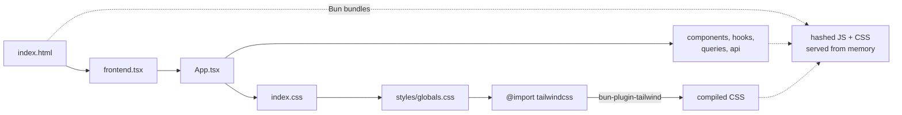

# Architecture

## Workspaces

Three Bun workspace packages. The dependency arrows only ever point *inward*,
toward the shared contract.

`@todo/shared` depends on nothing but Zod. It has no React and no Bun server
code, which is what lets both sides import it without dragging the other along.

The dotted arrow is the one code-level crossing between the two apps: the
server imports the web app's `index.html` so Bun can bundle it. That is
inherent to serving both from one process — it is a bundler entrypoint, not an
API call, and nothing else in `apps/server` imports from `apps/web`.

## One process, two responsibilities

Route precedence does the work: the two `/api/*` patterns are more specific
than `/*`, so the API is never shadowed by the catch-all, and every other path
returns the app shell so client-side URLs like `/?filter=active` load directly.

## How the frontend gets built

There is no Vite and no bundler config. `apps/server/src/index.ts` imports
`apps/web/src/index.html`, and Bun follows the graph from there.

Two things about this are easy to break:

- **The Tailwind plugin is registered in the root `bunfig.toml`**, and Bun
  resolves serve plugins from the *bunfig's* directory. So `bun-plugin-tailwind`
  is declared in the **root** `package.json`, not in `apps/web`.
- **`bunfig.toml` is read from the current working directory, with no upward
  search.** Running the dev server from a package directory — including via
  `bun run --filter` — finds no bunfig, loads no plugins, and serves the
  uncompiled `@import "tailwindcss"` as valid CSS. You get a 200, a stylesheet,
  no error, and a completely unstyled app. Always run `dev` and `start` from
  the repo root.

## Development vs production

| | `bun run dev` | `bun run start` |
|---|---|---|
| Server reload | `bun --hot` reloads the module | — |
| Client | HMR over a websocket | — |
| Bundling | lazy, re-bundled on change | lazy on first request, then cached in memory |
| Output | unminified | minified, with `Cache-Control` and `ETag` |

Both modes bundle in-process. There is no build step and no `dist/`: for a
single local process that is the whole production story, and it keeps one
bundling path rather than two that can disagree.

One cosmetic quirk: in production the emitted asset URLs look like
`/../../../chunk-abc123.css`. Bun derives them from the HTML entrypoint's
position relative to the server module, and the two live in different
packages. Browsers normalise the leading `..` segments away per RFC 3986, so
the assets resolve and the app is styled correctly — verified in a browser,
with no failed requests. It is ugly rather than broken. Dev mode is unaffected
and serves clean `/_bun/...` paths.

## Why not a server framework

An earlier plan put Elysia in front of the API. It was dropped. The API is four
endpoints, `Bun.serve({ routes })` is already a typed router with path params
and per-method handlers, and it is what makes HTML bundling and HMR work with
no configuration. Serving a Bun HTML bundle *through* Elysia runs into known
upstream problems ([#1515](https://github.com/elysiajs/elysia/issues/1515),
[#1347](https://github.com/elysiajs/elysia/issues/1347)) — the bundle gets
serialized as JSON rather than served as a document. The framework would have
cost the dev server and returned nothing at this size.

## TypeScript configuration

`tsconfig.base.json` deliberately declares **no `baseUrl` and no `paths`**. Bun
merges a parent tsconfig over a child and only overwrites `baseUrl` when the
parent has one, so a `baseUrl` in the base file would silently win over each
package's own and resolve `@/components/x` against the repo root.

TypeScript is pinned to **5.x, not 7.x**. TypeScript 7 removed `baseUrl`, but
Bun 1.3.6 still requires it for `paths` and does not implement the TS5+
fallback of resolving paths relative to the tsconfig's own directory. Under
TS 7 the config typechecks and every `@/` import then fails to bundle.
