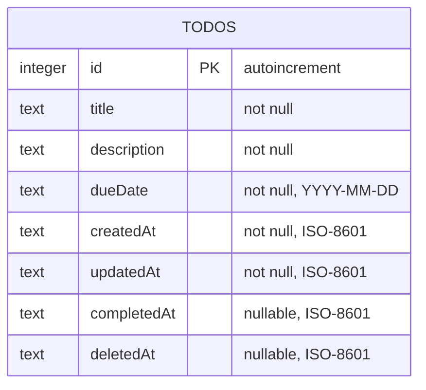
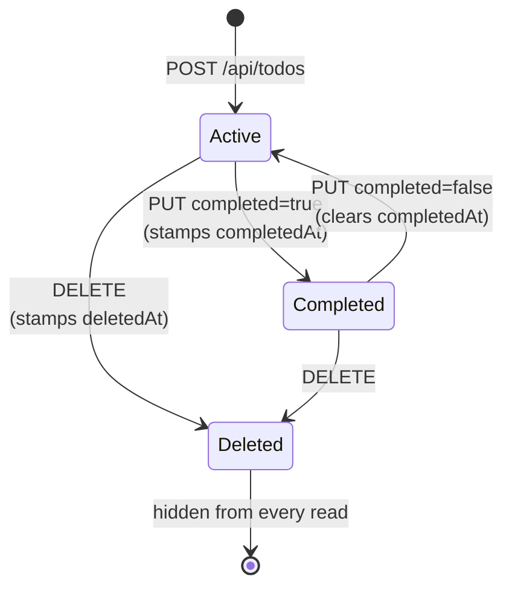
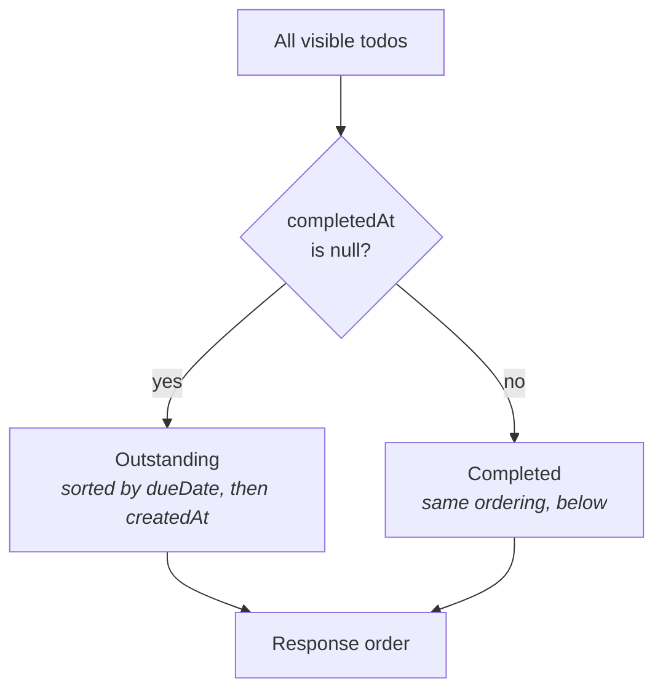

# Data model

One table. Defined in [`apps/server/src/db/schema.ts`](../apps/server/src/db/schema.ts),
migrated from [`apps/server/drizzle/`](../apps/server/drizzle).



Indexes on `deletedAt`, `completedAt` and `dueDate` — the three columns every
list query filters or orders by.

## Everything is TEXT

Dates and timestamps are stored as strings, not SQLite numerics. ISO-8601 and
`YYYY-MM-DD` both sort lexicographically in the same order they sort
chronologically, so `ORDER BY dueDate` is simply correct and needs no
conversion. `dueDate` is a bare calendar date with no time or zone: a todo is
due *on a day*, not at an instant.

## State is a timestamp, not a boolean



- **`completedAt IS NULL`** means outstanding. Non-null means done, and records
  *when*. Re-completing an already-complete todo keeps the original timestamp
  rather than restamping it.
- **`deletedAt IS NOT NULL`** means soft-deleted. The row stays on disk but is
  excluded from every read, under every filter. A second delete returns 404,
  because the row is no longer visible to the API.

Both are nullable timestamps rather than flags so the app records *when*
something happened without a second column, and a soft delete is recoverable
with a single `UPDATE`.

## Sort order

Incomplete first, then by due date, then by insertion order:

```sql
ORDER BY completedAt IS NOT NULL,  -- false (0) before true (1)
         dueDate ASC,
         createdAt ASC
```



The first key relies on SQLite evaluating `completedAt IS NOT NULL` as 0 or 1,
which sorts outstanding work above finished work. `createdAt` is the final
tiebreaker so two todos due the same day keep a stable, predictable order.

**Sorting is server-side only.** The client never re-sorts, which is why every
mutation invalidates the list — completing a todo has to move it, and only the
server knows where to.

## Where the file lives

Resolved from the server module, not the working directory:

```
apps/server/data/todos.sqlite
```

Override with `DATABASE_PATH`; tests pass `:memory:`. The directory is
gitignored along with the `-wal` and `-shm` siblings.
