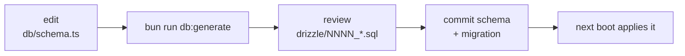

# Development

## Setup

```bash
bun install
bun run dev     # http://localhost:3000
```

Requires Bun 1.3.6+. Nothing else — no Node, no Vite, no separate database.
The SQLite file and its schema are created on first boot.

## Scripts

All are run **from the repo root**.

| Script | Does |
|---|---|
| `bun run dev` | Server hot-reload plus client HMR |
| `bun run start` | Production mode: minified, cached bundle |
| `bun test` | Every package |
| `bun run typecheck` | Every package |
| `bun run db:generate` | Generate a migration from the schema |

> **Do not run `dev` or `start` with `bun run --filter`.** Filtered scripts
> change the working directory, Bun reads `bunfig.toml` from the cwd with no
> upward search, and the Tailwind plugin is registered there. You get a 200, a
> stylesheet, no error, and a completely unstyled app. If you must run from a
> package directory: `bun --config ../../bunfig.toml --hot src/index.ts`.

## Layout

```
apps/server/     Bun.serve, Drizzle, migrations
apps/web/        React app, shadcn components, Tailwind theme
packages/shared/ Zod schemas — imported by both, depends on neither
docs/            this folder
```

## Changing the database schema



Migrations run automatically at startup (`migrate()` in
[`db/client.ts`](../apps/server/src/db/client.ts)), so there is no window where
the app is deployed but the schema is not. `bun run --filter @todo/server db:migrate`
applies them manually if needed.

Only `drizzle-kit generate` is used. `push`, `studio` and `migrate` all open a
database connection, and drizzle-kit has no `bun:sqlite` driver — it knows only
`better-sqlite3` and `@libsql/client`. `generate` is static analysis of the
schema file and needs no connection.

Commit the generated SQL and the `meta/` snapshot alongside the schema change.

## Tests

```bash
bun test                                  # all packages
bun test apps/server                      # route tests
bun test packages/shared                  # schema tests
```

74 tests, covering the layers where behaviour is decided:

| Where | Covers |
|---|---|
| `packages/shared` | required fields, date formats, the calendar guard, leap years, filter fallback |
| `apps/server` | soft-delete exclusion, every filter, sort order, validation, completion toggling, double delete |
| `apps/web` | list view precedence, including the data-wins-over-error regression |

Server tests build a fresh in-memory database per test via `createDb(":memory:")`,
so they are isolated and need no fixtures or teardown.

There are **no DOM tests**. The dialog behaviour (Escape, focus trap, focus
restore, Enter to submit) and the optimistic toggle are verified by hand
against a browser — see the checklist below.

## Manual checklist

Worth walking after any change to the list or the dialogs:

- [ ] Create with a blank title → inline error, dialog stays open
- [ ] Create valid → dialog closes, card lands in the right sort position
- [ ] Toggle complete → muted card, green "Completed" badge, moves down
- [ ] Filter to Active → completed items disappear, **exactly one** request
- [ ] Press Back → filter control and list both revert
- [ ] Delete → confirmation dialog, then the card disappears
- [ ] Escape closes a dialog; focus returns to the button that opened it
- [ ] Enter submits the form
- [ ] **Stop the server, then toggle** → toast appears and the list stays on
      screen. This is the regression that motivated the refactor.

## Adding a shadcn component

```bash
cd apps/web
bun run ui:add <name>
```

Run it from `apps/web` — the CLI reads `components.json` from the working
directory. Decline when it offers to overwrite `button.tsx`: it carries custom
`icon-sm` and `icon-lg` size variants that the stock component does not.
