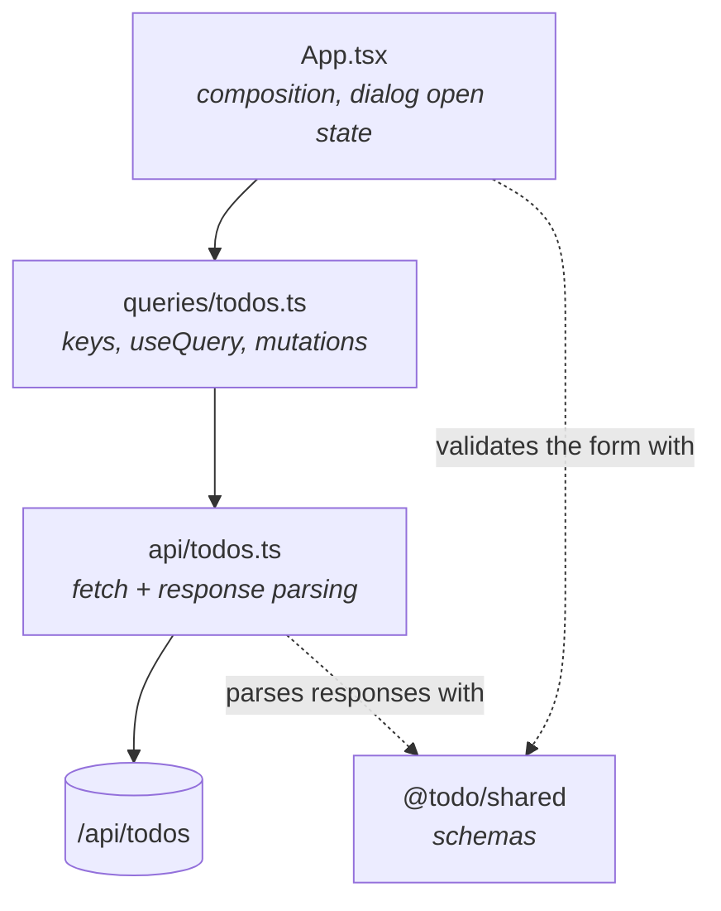
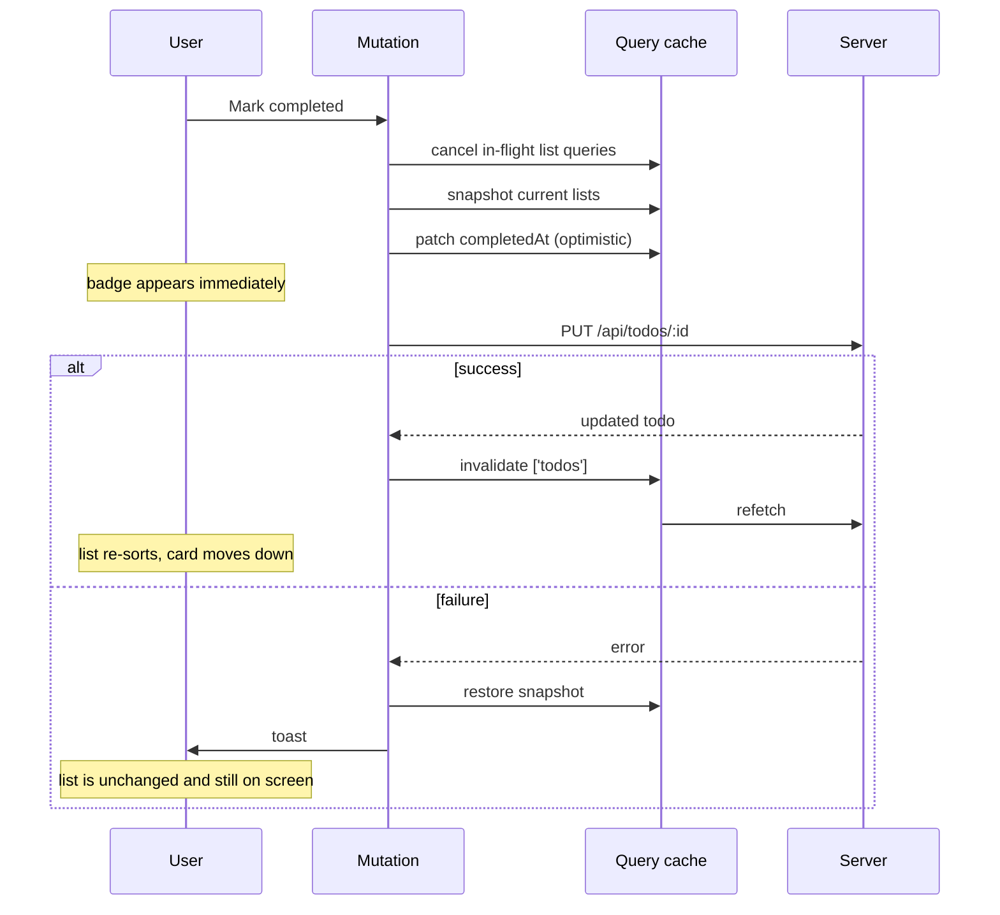
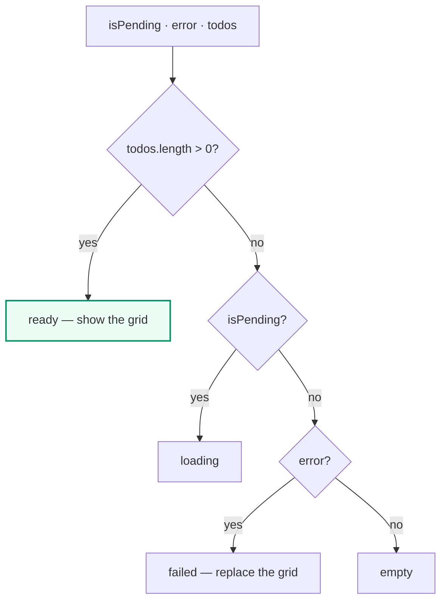
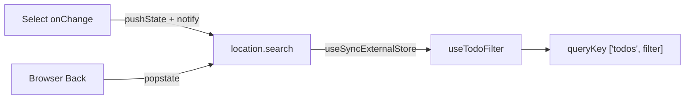

# Frontend

React 19. Server state is TanStack Query's job, forms are react-hook-form's,
and validation comes from `@todo/shared`. Very little state is hand-managed.

## Layers



`api/todos.ts` **parses** every response rather than casting it. A server
contract change fails loudly at that seam instead of surfacing as `undefined`
three components deep.

## Query keys and invalidation

```
['todos']            → everything (invalidation target)
['todos', filter]    → one list
```

Every mutation invalidates `['todos']`, which refetches whichever list is
mounted. That is what keeps the server-side sort authoritative: completing a
todo moves it, and only the server knows where to.



## The list view state

`toListView` collapses the query's state into one tagged value, and `App`
switches on the tag:

```ts
type TodoListView =
  | { status: 'loading' }
  | { status: 'failed'; message: string }
  | { status: 'empty' }
  | { status: 'ready'; todos: Todo[] }
```

**Precedence matters, and is the subject of the app's worst historical bug.**
Data wins over an error:



A failed write invalidates the list, and while the server is unreachable that
refetch fails too. If the error were checked first, a failed toggle would
replace the user's whole list with an error card — which is precisely the
defect this refactor set out to fix. Only a load with *nothing to show* may
replace the grid; otherwise the toast carries the error and the list stays.

This is pinned by a named test in
[`TodoListView.test.ts`](../apps/web/src/components/todo/TodoListView.test.ts).

## Errors reach the user in two different ways

| Kind | Surface | Why |
|---|---|---|
| List failed to load, nothing cached | replaces the grid | there is nothing else to show |
| Write failed (toggle, delete) | toast | the list is still valid and still useful |
| Field rejected on save | inline, under the input | it belongs to that input |

## The filter lives in the URL

`useTodoFilter` reads `?filter=` through `useSyncExternalStore` and subscribes
to `popstate`, so the Back button moves the UI. `pushState` does not fire
`popstate`, so the hook dispatches its own event to notify subscribers after
it writes.



Because the filter is part of the query key, changing it swaps lists through
the cache rather than being fetched imperatively — that is what reduced a
filter change from two requests to one.

## Forms

`TodoFormDialog` drives react-hook-form with `zodResolver(todoInputSchema)` —
the same schema the server uses. On rejection, server field errors are mapped
onto `setError`, so `{ errors: { title: … } }` lands under the title input, and
anything keyed `form` becomes a form-level message.

## Accessibility

The hand-written modal was replaced with shadcn's `dialog` and `alert-dialog`,
so Escape, the focus trap and the portal come from Radix. On top of that:

- Fields are in a real `<form>`, so Enter submits.
- Each error is tied to its input with `aria-describedby`, and the input is
  marked `aria-invalid` — screen readers announce the reason, not just that
  something is wrong.
- `useReturnFocus` restores focus to whatever opened a dialog. Radix returns
  focus to its own `DialogTrigger`; these dialogs are controlled with the
  trigger elsewhere, so without it focus fell back to `<body>`.
- Delete confirmation is an `alert-dialog`, replacing a `window.confirm` that
  sat inside the data layer where it could not be styled or tested.
